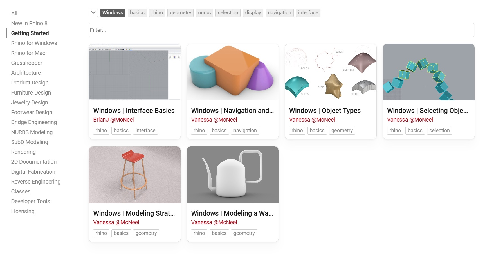
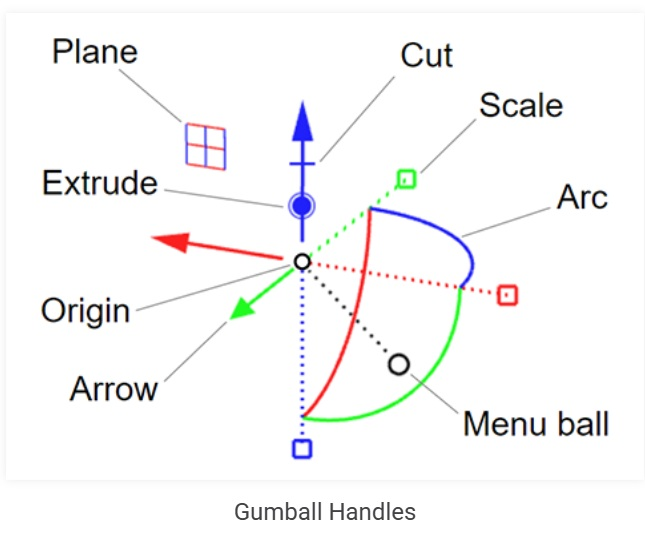

# Rhino3d
Rhino Website: https://www.rhino3d.com/

Getting Started Videos: [here](https://www.rhino3d.com/learn/?query=kind:%20jump_start%20tag:%20windows&modal=null)

Complete these Videos First!

## Basic Movement
Rotate - Right Click + Drag  
Pan - Shift + Right Click + Drag  
Zoom - Mouse wheel or Ctrl + Right Click + Drag  

## Setting the units scale for a new Project
Units command or File -> Properties -> Units  
Use the same unit for both model and layout.

## Get to know the Gumball

Rhino Guide: https://www.rhino3d.com/docs/guides/user-guide/gumball-basics/

## Sample Projects
[Coffee Mug](./coffee-mug/coffee-mug.md)

