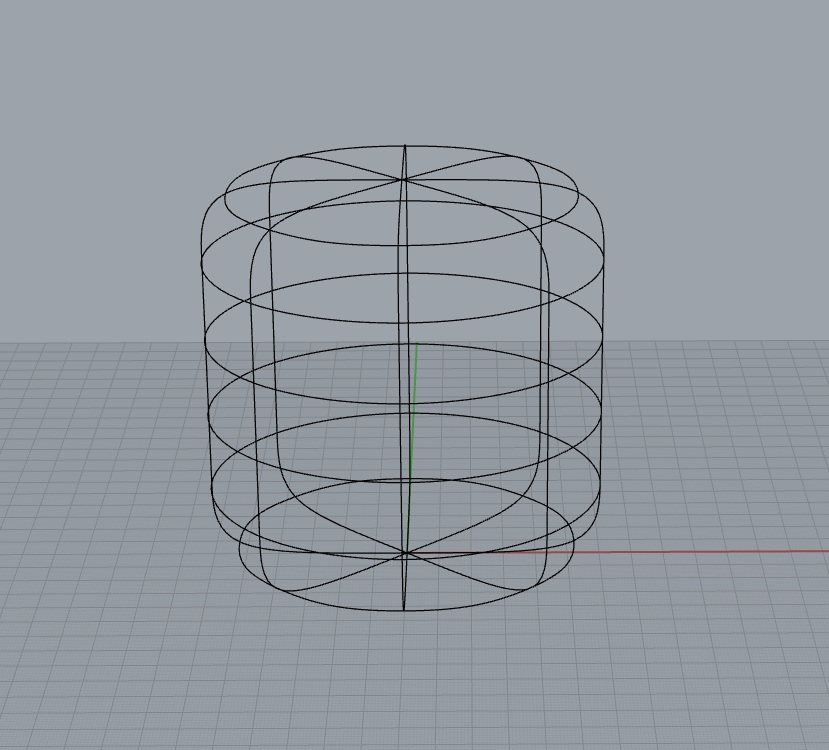
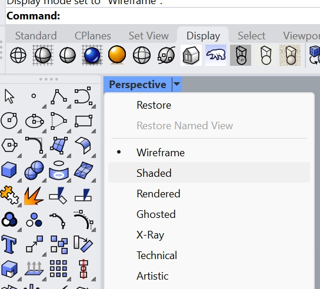
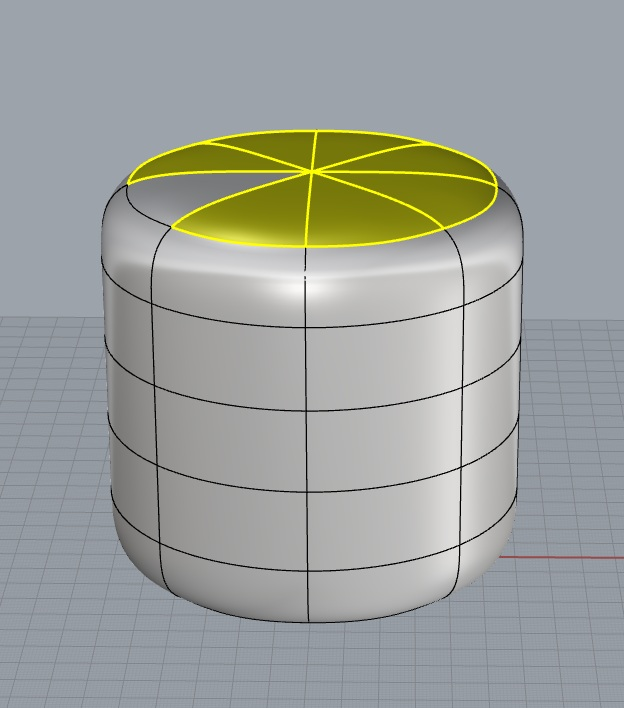
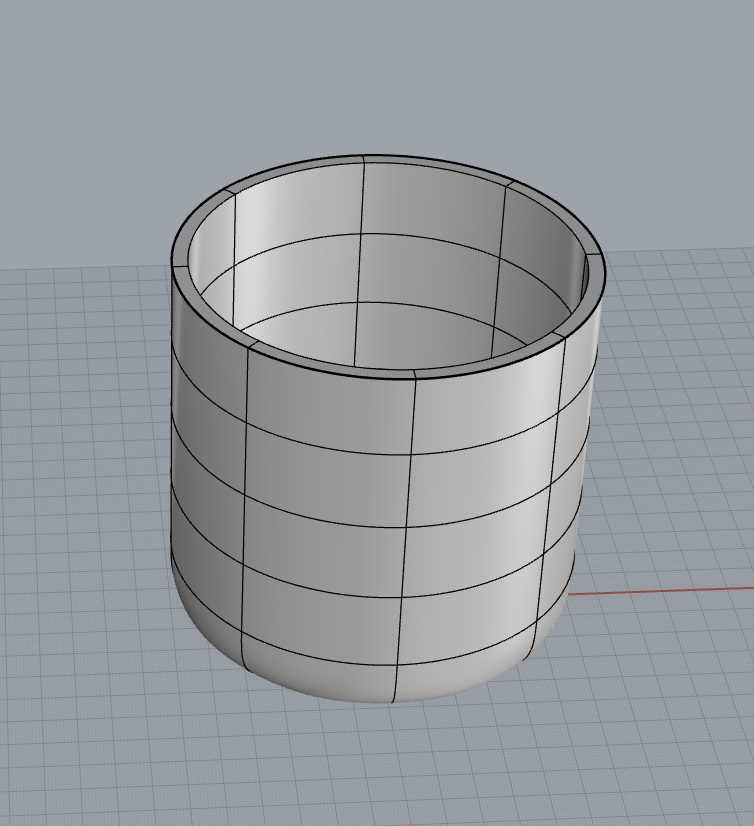
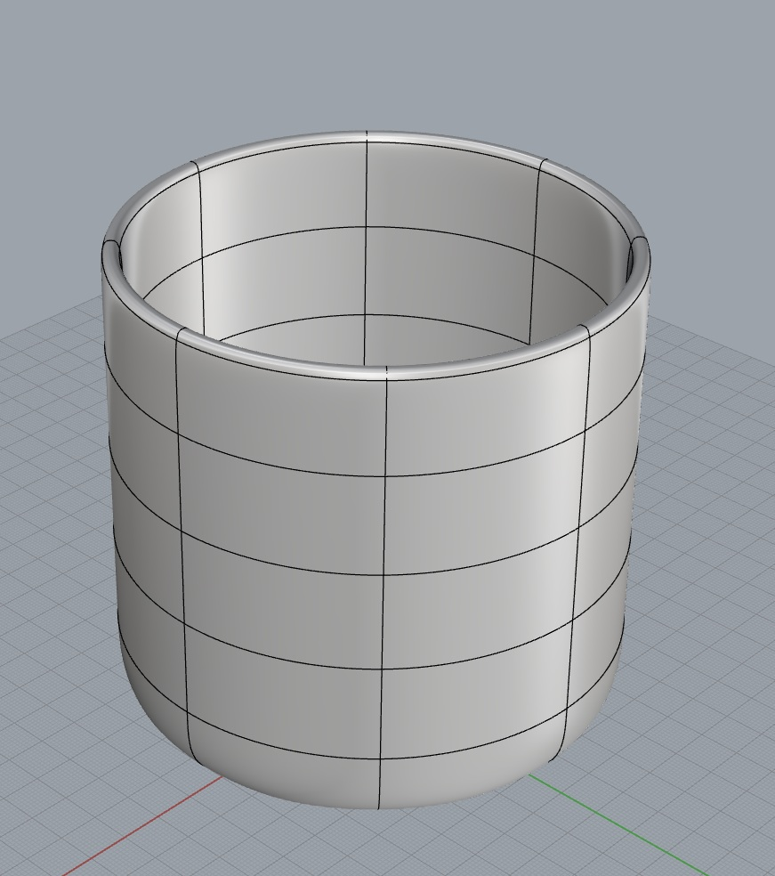
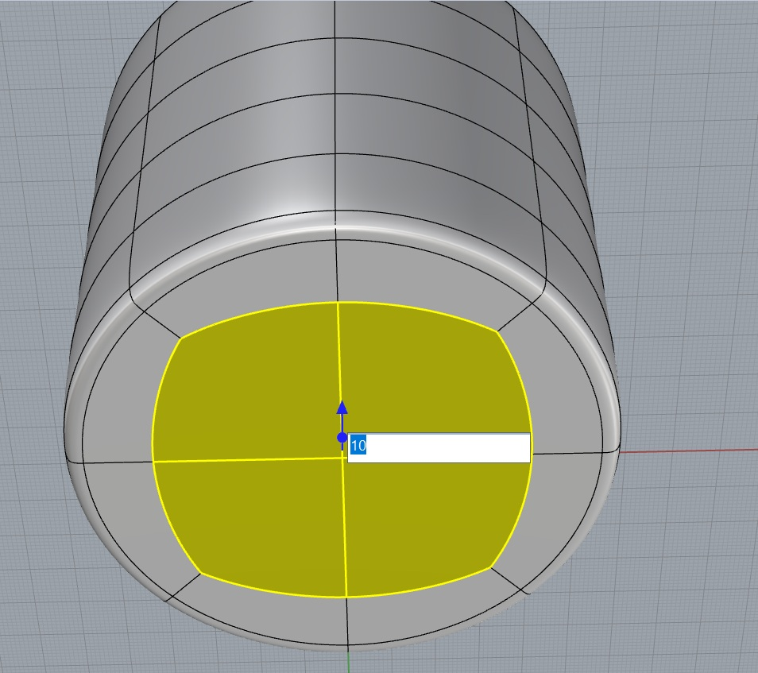
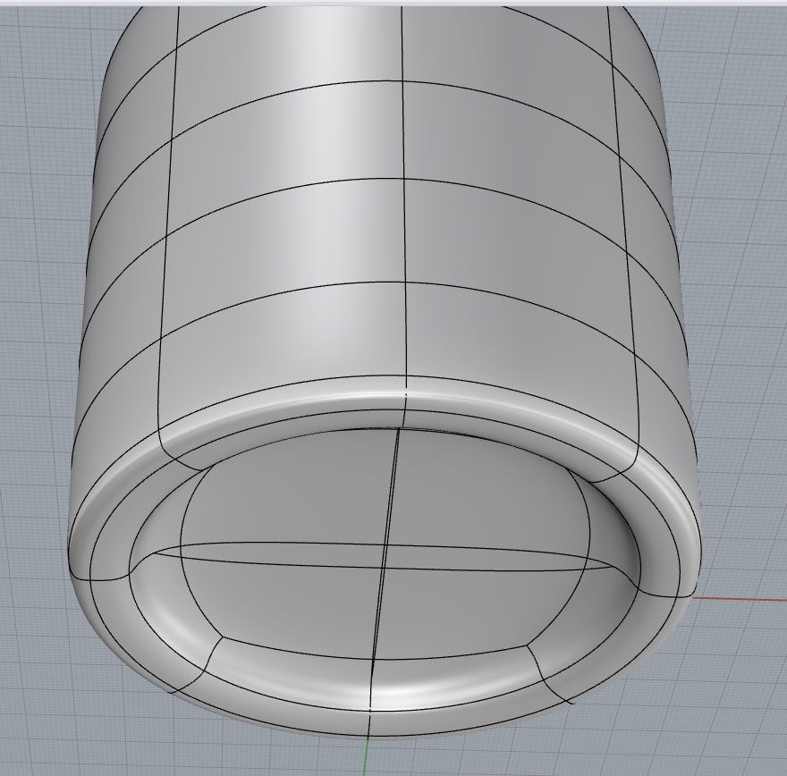
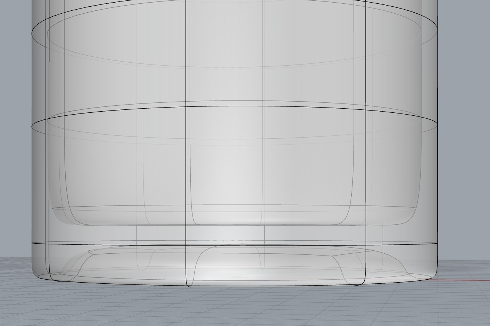
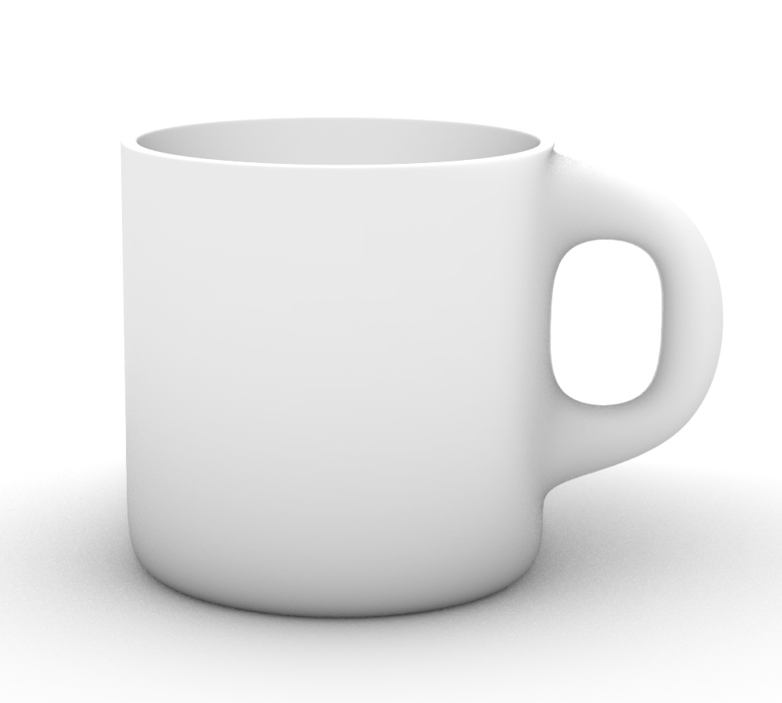

# Push & Pull SubD Modeling Technique

Video - https://vimeo.com/483173566?fl=pl&fe=sh


### 1. Insert SubD Cylinder Shape
**Command:** SubDCylinder

You can click on the map to set the center, radius and height or enter values on the command line. Change the CapFaceStyle=Quad

 ```
Base of cylinder ( DirectionConstraint=Vertical  Solid=Yes  2Point  3Point  Tangent  FitPoints  VerticalFaces=5  AroundFaces=8  CapFaceStyle=Tri ): 0,0,0
Radius <60.000> ( Diameter  Circumference  Area  ProjectOsnap=Yes ): 60
End of cylinder <100.000> ( DirectionConstraint=Vertical  BothSides=No ): 120
```



### 2. Enter Shaded Mode
You begin in Wireframe mode. To switch to shaded:
Perspective -> Shaded



### 3. Delete the top faces
Ctrl + Shift + Left Mouse Click to select a subface

Press delete to delete the selected faces  


### 4. Create Thickness
Ctrl + Shift + Left Mouse Click to select an edge  
Ctrl + Shift + Left Mouse Double Click to select a contiguous row of edges

**Command:** OffsetSubD

`Select object to flip offset direction. Press Enter when done ( Distance=5  Solid=Yes  BothSides=No  DeleteInput=No  FlipAll ): FlipAll`

Set the distance to the thickness.
Set Solid=Yes
Set DeletInput=Yes (to avoid ending up with two shapes)
Set FlipAll to thicken inside the existing shape




### 5. Smooth the edges
There are two options for smoothing edges: RemoveCrease and SubDCrease

SubDCrease allows you to speficy a weight controlling the rounding effect. RemoveCrease can leave narrow edges (weight=0). I will use SubDCrease with a weight of 25.

**Command:** SubDCrease

Click on ConstantWeight or type "o" and enter 25. Click enter again to finish.  

```
Select highlighted vertex. Press Enter to finish ( CreaseAll  ConstantWeight  SmallerText  LargerText ): ConstantWeight
Weight for all selected edges (0=smooth to 100=heaviest). Press Enter when done ( Crease  SmallerText  LargerText ): 33
Select highlighted vertex. Press Enter to finish ( CreaseAll  ConstantWeight  SmallerText  LargerText )
1 SubD changed.
```




Press tab to switch between flat (box) and smooth display.  

### 6. Create a depression on the bottom of the mug (Time 00:50)

I can't get this ctrl+shift clicking instructions to work on Rhino8.

ChatGPT says to use the Inset command. I used an Inset of 10 to define the width of the ring around the recessed center. 

I then clicked on the vertical axis handle once to open a dialog box to enter a value. I used 10.  

I also deleted a lower edge loop on the outside and lowered the next highest loop to get less of a rounded shape on the outside bottom.  



Resulting in a nice recessed bottom  



### 7. Raise the inside bottom
The inside bottom is below the outsite bottom now. I had to raise the inner bottom faces and then delete an edge loop and slide down a higher edge loop to get the shape I was going for.  



### 8. Add the handle

Now I need that edge loop back that I deleted earlier. I'll try just raising the lower edge loop.

Bevel - set KeepCreases = No  

Here it is in Rendered view



